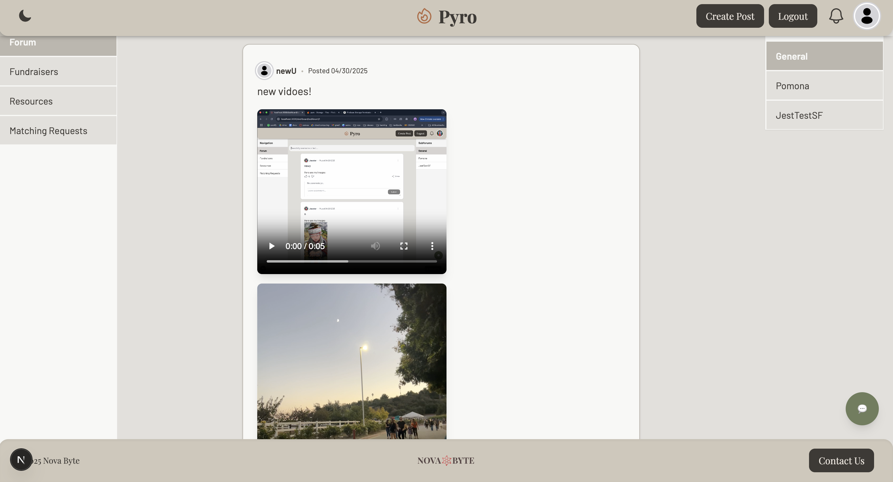

# Pyro — Wildfire Relief & Community Support

<p align="center">
  <strong>Connecting communities. Supporting recovery. Rebuilding together.</strong>
  <br />
  A community-driven platform for wildfire relief, information sharing, and support.
  <br />
  <strong>NOTE:</strong> Pyro is not currently online. The application can be viewed in guest mode but functionality requiring an account is not currently accessible. We appreciate your understanding.
  <br />
  <a href="https://pyro-home.vercel.app/"><strong>🌐 Visit Pyro</strong></a>
  &nbsp;·&nbsp;
  <a href="https://github.com/NovaByte-CS4800-Group-2/pyro">GitHub Repository</a>
</p>

---

## About

**Pyro** is a wildfire relief and community support forum developed as a collaborative software engineering project. It provides a centralized platform where individuals and communities affected by wildfires can connect, share information, participate in discussions, and support recovery efforts.

Designed with community collaboration in mind, Pyro aims to make it easier for people to communicate and find support during challenging circumstances.

## Our Mission

Wildfires can disrupt communities, displace families, and create urgent needs for information and assistance.

Pyro aims to bridge these gaps by providing an accessible online space for:

- Connecting wildfire-affected individuals and communities.
- Sharing experiences, information, and recovery resources.
- Encouraging community engagement and mutual support.
- Making conversations and support easier to access in one place.

## Features

| Feature | Description |
|---|---|
| Community Forums | Participate in discussions and share information with other community members. |
| Subforums | Organize discussions into dedicated community spaces. |
| User Profiles | Access personalized profiles and profile information. |
| Authentication | Create accounts and securely sign in using Firebase Authentication. |
| Profile Images | Store and retrieve profile images using Firebase Storage. |
| Responsive Design | Navigate the platform across different screen sizes. |
| AI Chatbot | Interact with an integrated chatbot for additional assistance. |

## Tech Stack

<p align="center">
  
  
  
  
  
  
</p>

| Technology | Purpose |
|---|---|
| Next.js | Frontend framework and application routing |
| React | Component-based user interface |
| TypeScript | Type-safe application development |
| Tailwind CSS | Styling and responsive layouts |
| HeroUI | UI component library |
| Firebase Authentication | User authentication |
| Firebase Storage | Profile image storage |
| Vercel | Frontend deployment |

## Screenshots

<!-- Replace these paths with screenshots committed to your repository. -->

| Homepage | Community Forum |
|:---:|:---:|
|  |  |

| User Profile | Additional Features |
|:---:|:---:|
|  |  |

## Getting Started

Follow these instructions to run Pyro locally.

### Prerequisites

- [Node.js](https://nodejs.org/) and npm
- [Git](https://git-scm.com/)
- A Firebase project with the necessary services configured
- Backend configuration required by the application

### Installation

**1. Clone the repository**

```bash
git clone https://github.com/NovaByte-CS4800-Group-2/pyro.git
cd pyro
```

**2. Configure the frontend**

```bash
cd client
npm install
```

**3. Configure environment variables**

Create a `.env.local` file inside `client/` and configure the Firebase, Google, and MySQL credentials and backend URL used by the application.

```env
NEXT_PUBLIC_BACKEND_URL=
GOOGLE_CLIENT_ID=
GOOGLE_CLIENT_SECRET=
DATABASE_URL=
NEXT_PUBLIC_FIREBASE_API_KEY=
NEXT_PUBLIC_FIREBASE_AUTH_DOMAIN=
NEXT_PUBLIC_FIREBASE_DATABASE_URL=
NEXT_PUBLIC_FIREBASE_PROJECT_ID=
NEXT_PUBLIC_FIREBASE_STORAGE_BUCKET=
NEXT_PUBLIC_FIREBASE_MESSAGING_SENDER_ID=
NEXT_PUBLIC_FIREBASE_APP_ID=
NEXT_PUBLIC_FIREBASE_MEASUREMENT_ID=
MYSQL_HOST=
MYSQL_USER=
MYSQL_PASSWORD=
MYSQL_DATABASE=
```

Use the appropriate values from your project and backend configuration. Refer to the application configuration for any additional required variables.

**4. Start the frontend**

```bash
npm run dev
```

**5. Open the application**

Navigate to:

[http://localhost:3000](http://localhost:3000)

### Production Build

From the `client` directory:

```bash
npm run build
npm run start
```

## Project Structure

```text
pyro/
├── client/                 # Next.js frontend
│   ├── src/
│   │   └── app/            # App Router pages and components
│   └── package.json
│
├── server/                 # Backend application
│
├── .firebaserc             # Firebase project configuration
├── firebase.json            # Firebase configuration
├── package.json             # Root package configuration
├── package-lock.json
└── README.md
```

## Team

Developed by **NovaByte — CS4800 Group 2** as part of a collaborative software engineering project.

Our team worked together to design, develop, and deploy a community-focused platform addressing the challenges associated with wildfire recovery.

## Live Demo
<strong>NOTE:</strong> Pyro is not currently online. The application can be viewed in guest mode but functionality requiring an account is not currently accessible. We appreciate your understanding.

<p align="center">
  <a href="https://pyro-home.vercel.app/">
    
  </a>
</p>

**[pyro-home.vercel.app](https://pyro-home.vercel.app/)**

## Disclaimer

Pyro is a community support platform and is not an official emergency response service.

Always rely on official emergency alerts, evacuation instructions, and verified relief organizations for emergency assistance and safety-critical information.

---

<p align="center">
  <strong>Built with ❤️ to support communities affected by wildfires.</strong>
  <br />
  <sub>NovaByte · CS4800 Group 2</sub>
</p>